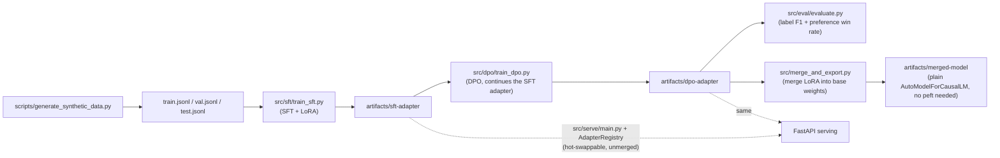

# Conversational LLM Fine-Tuning: SFT + DPO + LoRA/QLoRA

A small, end-to-end fine-tuning pipeline that turns a base instruct model
into a **conversational signal classifier + compliant-response suggester**:
given a customer utterance, predict which of a fixed set of conversational
signals it represents (an objection, a buying signal, an escalation risk, a
question, or neutral) and suggest a short, policy-compliant response.

It runs the *whole* pipeline — synthetic data generation, supervised
fine-tuning (SFT), preference optimization (DPO), evaluation, and merge/
export for serving — on a CPU, in minutes, with a genuinely tiny model, so
you can clone this and watch every stage actually execute before spending
real GPU time on a real model. See ["What this tutorial-scale run does and
doesn't prove"](#what-this-tutorial-scale-run-does-and-doesnt-prove) below
for exactly what the CPU/tiny-model numbers in this README do and don't
tell you.

## Why fine-tune at all, instead of just prompting a hosted model?

You don't always need to. If your task is small in volume, tolerant of
per-call API latency, and fine with sending data to a third-party API, a
well-prompted hosted model is simpler and should be your first attempt. Fine
a smaller local model becomes worth its complexity when:

- **You call it on every turn of a live, latency-sensitive conversation**
  (see the companion `real-time-conversation-signal-copilot` and
  `low-latency-llm-serving-benchmark` repos) — a local, batchable model has
  a fundamentally different latency/cost curve than a hosted API call per
  turn.
- **The task is narrow and repetitive** — a fixed label taxonomy plus a
  short, templated-style response is exactly the kind of task a small model
  can be taught to do reliably, without needing a frontier model's broad
  world knowledge.
- **You need the data to stay on infrastructure you control**, because it's
  real (redacted) customer conversation content.

See [`docs/adr/0003-small-local-model-vs-hosted-api.md`](docs/adr/0003-small-local-model-vs-hosted-api.md)
for the full reasoning, including when this bet does *not* pay off.

## The pipeline



**Why two stages (SFT then DPO), not one.** SFT teaches the model the
output *format* — `Label: X\nResponse: ...` — via ordinary next-token
prediction. DPO then teaches a *preference*: given the same prompt, score
the compliant response higher than an over-promising one. Trying to run DPO
against a model that's never seen the target format gives it no reliable
signal to sharpen. See
[`docs/adr/0002-sft-then-dpo-vs-single-stage.md`](docs/adr/0002-sft-then-dpo-vs-single-stage.md).

**Why LoRA, not full fine-tuning.** LoRA's trainable parameters are a small
fraction of the base model's, which is what makes fine-tuning fit in modest
memory and makes adapters small enough to hot-swap in production without
reloading the base model. See
[`docs/adr/0001-lora-vs-full-finetune.md`](docs/adr/0001-lora-vs-full-finetune.md).

## Repository layout

```
scripts/generate_synthetic_data.py  # synthetic {utterance, label, chosen, rejected} generator
src/
  taxonomy.py                       # the 5-label signal vocabulary + prompt template
  data/format.py                    # shared prompt/target formatting (SFT and DPO both import this)
  sft/train_sft.py                  # stage 1: SFT + LoRA
  dpo/train_dpo.py                  # stage 2: DPO, continues the SFT adapter
  eval/metrics.py                   # label F1 + DPO preference win rate, unit-tested against hand cases
  eval/evaluate.py                  # runs metrics.py against a trained adapter + test.jsonl
  merge_and_export.py               # merge LoRA into base weights -> plain model dir for serving
  serve/
    model_registry.py               # AdapterRegistry: hot-swappable, unmerged adapters
    main.py                         # FastAPI: /classify, /suggest_response, /adapters
tests/                              # pytest -- see "Testing" below
docs/
  adr/                              # why LoRA, why SFT->DPO, why a small local model
  PRODUCTION.md                     # dataset versioning, MLflow, promotion gates, canary, sizing
Dockerfile, docker-compose.yml      # serving image (training is not meant to run in this container)
```

## Setup

```bash
python -m venv .venv && source .venv/bin/activate   # or .venv\Scripts\activate on Windows
# torch has separate CPU/CUDA wheel indexes pip can't express in one requirements
# line -- install it first, from the index matching your hardware:
pip install torch --index-url https://download.pytorch.org/whl/cpu   # CPU
# pip install torch                                                  # or: let pip pick a CUDA build
pip install -r requirements.txt
```

## Run the pipeline yourself

```bash
python scripts/generate_synthetic_data.py                 # writes data/synthetic/{train,val,test}.jsonl
python src/sft/train_sft.py                                # -> artifacts/sft-adapter
python src/dpo/train_dpo.py                                 # -> artifacts/dpo-adapter (continues the SFT adapter)
python src/eval/evaluate.py --adapter-dir artifacts/dpo-adapter
python src/merge_and_export.py --adapter-dir artifacts/dpo-adapter  # -> artifacts/merged-model
```

By default all four scripts use `sshleifer/tiny-gpt2` — a real but
randomly-initialized, ~5MB GPT-2, chosen so the whole pipeline runs on CPU
in minutes for anyone who just cloned this repo. Pass
`--model-name HuggingFaceTB/SmolLM2-135M-Instruct` (or a similarly small,
ungated instruct model) to any of the training/eval/merge scripts to see
what an *actually pretrained* small model does with the same pipeline — see
the real, measured comparison below.

### Serve it

```bash
docker compose up --build
# or directly:
uvicorn src.serve.main:app --reload
```

```bash
curl -X POST localhost:8080/classify -H 'content-type: application/json' \
  -d '{"utterance": "Honestly this feels too expensive for what I get."}'
```

## What this tutorial-scale run does and doesn't prove

This repo's own tests and the numbers below all default to
`sshleifer/tiny-gpt2` on purpose — it lets anyone clone this repo and watch
the *entire* SFT → DPO → eval → merge pipeline run for real, on CPU, in
minutes, with no GPU and no multi-gigabyte download. Every number below was
actually produced by running these scripts in this repo's own CI/dev
environment (see each command shown) — none are invented.

**tiny-gpt2 (pipeline-correctness run, not a quality result):**

```
$ python src/eval/evaluate.py --adapter-dir artifacts/dpo-adapter
{
  "n_examples": 40,
  "label_metrics": { "accuracy": 0.0, "macro_f1": 0.0, "parse_failure_rate": 1.0 },
  "preference_win_rate": 0.1
}
```

`sshleifer/tiny-gpt2` is a genuinely tiny, **randomly-initialized** GPT-2 (a
few KB of weights) — it has no language-modeling ability at all, so a 0%
parse rate and 0% accuracy are exactly what its own docstring in
`src/sft/train_sft.py` predicts. What this run *does* prove: the data format
pipeline, the LoRA training loop, the DPO continuation-from-SFT-adapter
logic, the evaluation harness, and the merge/export step are all wired
together correctly end to end — every one of those would fail loudly (not
silently produce a plausible wrong number) if the plumbing were broken. That
mechanical correctness is what `tests/test_training_smoke.py` asserts in
CI on every push.

**Merge/export, measured on the tiny-gpt2 adapter:**

```
$ python src/merge_and_export.py --adapter-dir artifacts/dpo-adapter --out-dir artifacts/merged-tiny-gpt2
{
  "merge_seconds": 0.0116,
  "adapter_weights_bytes": 3944,
  "merged_weights_bytes": 413296
}
```

**Why this README doesn't show a "real model, real quality" number too.**
We tried: the same pipeline against `HuggingFaceTB/SmolLM2-135M-Instruct`
(134.5M real pretrained params) loads, tokenizes, and starts training
without any code error — the pipeline mechanics are identical regardless of
which model you point `--model-name` at. But the **first training step
alone measured ~572 seconds** on this repo's own CPU sandbox (`1/90
[09:32<14:08:48, 572.23s/it]` — that `it/s` estimate is real tqdm output
from the actual run), which extrapolates to over 14 hours for the full
3-epoch/240-example job. We stopped it there rather than let a "smoke test"
run for 14 hours. This is itself an honest, useful, measured data point:
**CPU is not a viable environment for training even a 135M-parameter model
past a couple of steps** — see the LoRA-rank-vs-VRAM sizing table in
[`docs/PRODUCTION.md`](docs/PRODUCTION.md) for what a real GPU changes here.
If you have a GPU (even a modest one), the exact same command will run in a
small fraction of that time:

```bash
python src/sft/train_sft.py --model-name HuggingFaceTB/SmolLM2-135M-Instruct
python src/dpo/train_dpo.py --model-name HuggingFaceTB/SmolLM2-135M-Instruct
python src/eval/evaluate.py --model-name HuggingFaceTB/SmolLM2-135M-Instruct --adapter-dir artifacts/dpo-adapter
```

## Testing

```bash
pytest tests/ -q
```

29 tests, all fast (the heaviest is a real end-to-end SFT+DPO smoke run on
`tiny-gpt2` with 3 training steps each — well under a minute). This is
exactly what `.github/workflows/ci.yml` runs on every push; no test in this
suite needs a GPU or downloads more than a few KB of model weights beyond
the tiny-gpt2/small-tokenizer files, which are cached after the first run.

Running the same scripts with a real small instruct model (as shown above)
is a deliberate, separate, manual step — not part of CI — because it's
slower and its point is output *quality*, not pipeline correctness, which
is what the fast suite already checks on every push.

## License

MIT -- see [LICENSE](./LICENSE).

---


### Thank you for reading

#### Please consider giving a star if you find the repo useful. Thank you.

---

### **AUTHOR'S BACKGROUND**
### Author's Name:  Emmanuel Oyekanlu
```
Skillset:   I have experience spanning several years in data science, enterprise AI architecture and solutions, developing scalable enterprise data pipelines,
enterprise solution architecture, architecting enterprise systems data and AI applications,
software and AI solution design and deployments, data engineering, industrial intelligent vision systems, high performance computing (GPU, CUDA), machine learning,
NLP, Agentic-AI and LLM applications as well as deploying scalable solutions (apps) on-prem and in the cloud.

I can be reached through: manuelbomi@yahoo.com

website: https://www.emmanueloyekanlu.com/
Publications:  https://scholar.google.com/citations?user=S-jTMfkAAAAJ&hl=en
LinkedIn:  https://www.linkedin.com/in/emmanuel-oyekanlu-6ba98616
Github:  https://github.com/manuelbomi

```
[](https://skillicons.dev)
